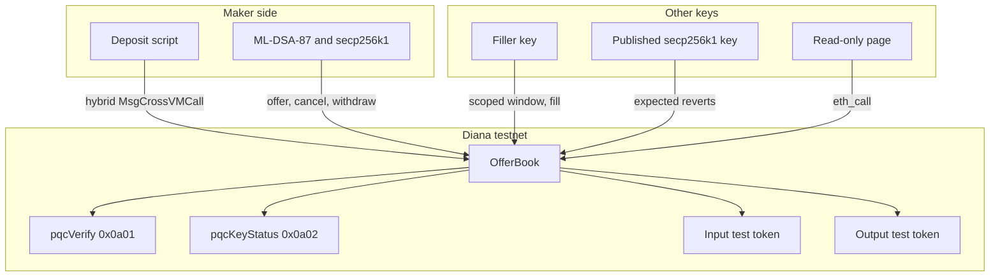

# Implementation plan

This is the spec for the contest build of FIRM. If a later change disagrees with a test named here, update this file in the same commit. The README is the short version. This is the one to build from.

The aim is one Diana deployment where a maker locks test tokens, signs a falling price with ML-DSA-87, a published secp256k1 key fails to pull the offer, and a second key fills at the price the contract computes. A second, smaller offer shows a cancel that has waited out its delay. Everything else can wait.

## How the pieces fit



`OfferBook` holds the inventory and the idle balance. It has no owner. The filler pays the output token and receives the input token. The page never holds a key.

There is no proxy and no upgrade path. If the book is wrong, makers withdraw with the ML-DSA key and we deploy a new address. Say that in the README in plain words.

## Repository layout

Create a directory when the first file in it is real. Empty folders are not useful.

```text
FIRM/
  README.md
  IMPLEMENTATION.md
  AI_USAGE.md
  foundry.toml
  contracts/
    OfferBook.sol
    interfaces/IQorePQC.sol
    libraries/Curve.sol
  test/
    OfferBook.t.sol
    Curve.t.sol
    OfferBook.invariants.t.sol
    mocks/PqcMock.sol
    vectors/offer.json
  script/
    live/spike.ts
    live/deposit.ts
    live/open.ts
    live/attacker.ts
    live/fill.ts
    live/cancel.ts
  web/
    index.html
    src/main.ts
  docs/
    AUDIT.md
    audit/
```

`foundry.toml` sets `solc` 0.8.28, optimizer on, and a `diana` profile whose RPC is `https://evm-testnet.qore.host`. Chain id 9800. Do not commit a funded mnemonic. Forge runs under WSL2. The repo lives on the Windows disk, so the WSL path is `/mnt/c/Users/HP/Documents/FIRM`.

The scripts and the page use Node 22 and viem. Signing uses `@noble/post-quantum` (`ml_dsa87`) with a deterministic signature and an empty context string, and `@qorechain/pqc` where it matches those bytes. If the two libraries ever disagree, the Diana precompile is the referee, and the vector file is updated to the bytes Diana accepts.

`IQorePQC.sol` is copied from the QoreChain precompile docs and credited in the README. The interface:

```solidity
interface IQorePQC {
    function pqcVerify(bytes calldata pubkey, bytes calldata signature, bytes calldata message)
        external
        view
        returns (bool valid);

    function pqcKeyStatus(address account)
        external
        view
        returns (bool registered, uint8 algorithmId, bytes memory pubkey, bool possessionProven);
}
```

Addresses, as constants:

| Name | Value |
| --- | --- |
| `PQC_VERIFY` | `0x0000000000000000000000000000000000000a01` |
| `PQC_KEY_STATUS` | `0x0000000000000000000000000000000000000a02` |
| Algorithm id | `1` (ML-DSA-87) |
| Public key length | 2592 |
| Signature length | 4627 |

A call to an address that is not an active precompile returns empty data and does not revert. Every low-level call checks `success` and the return length before `abi.decode`. A typed interface call reverts on empty data, which is the safe outcome, so prefer the typed interface. The live probe still asserts the length, in case a future change switches the call style.

Do not send QOR to these addresses. They are not payable.

## Keys

Four roles. Three of them can share a machine. They do not share a key.

| Role | What it holds | What it can do |
| --- | --- | --- |
| Deployer | A fresh testnet account | Deploy, then close its window. It never holds inventory |
| Maker | secp256k1 plus ML-DSA-87, registered with a proof of possession | Deposit, sign offers, sign cancels, sign withdraws |
| Filler | Its own registered account, funded with the output token | `fill` |
| Attacker | The maker's secp256k1 key only, pasted into `attacker.ts` | The three failing calls in the video |

The ML-DSA seed stays in an env file that is gitignored. The video may show the secp256k1 key. It may not show the ML-DSA seed. The account is a fresh Diana account that has never held mainnet funds.

Register with `MsgRegisterPQCKeyV2` and a proof of possession before any offer. On Diana, from v3.2.8, a new account's first transaction has to be that registration. `possessionProven` must be true. `registered` alone is a fail.

Opening a window, deploying, and closing the window are hybrid native transactions. A scoped window refuses contract creation, so the deploy window is a short unscoped one, closed in the next transaction. After that, the deployer window stays closed.

## Tokens

Do not hardcode a token address from memory. At the start of implementation, read the current Diana test-token page and pin two official tokens in the README, with decimals and the docs URL.

Until that pin exists, tests use two 18 decimal mocks, `TIN` and `TOUT`. The curve's scale is `1e18`: price is output base units per `1e18` input base units. Payment is `amountIn * price / 1e18`. Both tokens at 18 decimals make "20" mean 20 whole tokens. If the official output token uses 6 decimals, the demo numbers in the README change and the scale stays `1e18`. The contract does not read `decimals()`. The signer is responsible for the units. The page prints both raw units and whole tokens using the decimals we pinned.

The constructor takes the two token addresses and stores them as immutables. Any other token reverts. That is the whole allowlist. There is no function to add a third.

## The signed bytes

One encoding, used by Solidity and by TypeScript. The precompile verifies the bytes it is given. It does not hash them first. We sign the `abi.encode` payload itself, and the contract rebuilds that payload and passes it through.

Offer, domain string `FIRM_OFFER_V1`:

```solidity
abi.encode(
    keccak256("FIRM_OFFER_V1"),
    block.chainid,
    address(this),
    maker,
    tokenIn,
    tokenOut,
    amountIn,
    startPrice,
    endPrice,
    startTime,
    endTime,
    recipient,
    cancelDelay,
    nonce,
    feeBps,
    feeRecipient
)
```

Cancel, domain string `FIRM_CANCEL_V1`:

```solidity
abi.encode(
    keccak256("FIRM_CANCEL_V1"),
    block.chainid,
    address(this),
    offerId,
    maker,
    actionNonce
)
```

Withdraw, domain string `FIRM_WITHDRAW_V1`:

```solidity
abi.encode(
    keccak256("FIRM_WITHDRAW_V1"),
    block.chainid,
    address(this),
    maker,
    token,
    amount,
    actionNonce
)
```

`test/vectors/offer.json` holds one offer, one cancel, and one withdraw: the encoded hex, the signature hex, and the public key hex. Forge and the TypeScript signer both load it. A mismatch fails CI.

`nonce` is the maker's offer nonce, stored in the book, and it must equal the value signed. It increments on a successful open. `actionNonce` is a second counter for cancel and withdraw, so an offer signature cannot be replayed as a cancel. Each successful cancel or withdraw increments it.

The contract reads the public key from `pqcKeyStatus(maker)` at the moment of the call. It does not cache the key at deposit. A rotated key can cancel. An old key cannot. The outer transaction carries the signature only. The contract passes the key it just read into `pqcVerify`.

## Curve

`Curve.sol` is pure.

```text
if endTime <= startTime: revert
if t <= startTime:        startPrice
if t >= endTime:          endPrice
if endPrice >= startPrice:
    startPrice + (endPrice - startPrice) * (t - startTime) / (endTime - startTime)
else:
    startPrice - (startPrice - endPrice) * (t - startTime) / (endTime - startTime)
```

`payment(amountIn, price) = amountIn * price / 1e18`. Require the payment to be greater than zero.

Bounds for an open:

| Check | Bound |
| --- | --- |
| `amountIn` | Greater than zero, and at most the maker's idle balance |
| `startTime` | Strictly before `endTime` |
| Duration | At least 60 seconds, at most 7 days |
| `cancelDelay` | At least 1 block, at most 7,200 blocks |
| `feeBps` | At most 100. The demo signs 0 |
| `feeRecipient` | Zero address when the fee is 0, and a non-zero address when it is not |
| `recipient` | Non-zero, and not the book |
| Tokens | Exactly the two constructor tokens, and different from each other |
| `startPrice` and `endPrice` | Both greater than zero |

7,200 blocks on Diana is a few hours. The cap exists so a typo cannot freeze inventory for a month. The maker can still withdraw idle funds. They cannot pull an open offer faster than the delay they signed.

## OfferBook

### Storage

```solidity
enum Status {
    None,
    Open,
    Filled,
    CancelPending,
    Cancelled
}

struct Offer {
    address maker;
    address tokenIn;
    address tokenOut;
    uint256 amountIn;
    uint256 startPrice;
    uint256 endPrice;
    uint256 startTime;
    uint256 endTime;
    address recipient;
    uint64 cancelDelay;
    uint16 feeBps;
    address feeRecipient;
    uint64 cancelReadyAt;
    Status status;
}
```

`offers` is a mapping from id to `Offer`. `nextId` starts at 1. Id 0 means "no offer".

`idle[maker][token]` is the balance the maker can withdraw or turn into an offer. `reserved[token]` is the sum of input sitting in open and cancel-pending offers. The invariant is:

```text
token.balanceOf(book) == reserved[token] + sum of idle balances for that token
```

Output tokens are not held. The filler pays the recipient directly. A fee, when it is non-zero, is a second `transferFrom` from the filler. The contest recording uses a zero fee, and the tests still cover a 1 percent fee.

`nonces[maker]` and `actionNonces[maker]` are `uint256`.

### deposit

```solidity
function deposit(address token, uint256 amount) external
```

`token` is one of the two immutables. `amount > 0`. Pull `amount` from `msg.sender` with `safeTransferFrom`. Credit `idle[msg.sender][token]`. Emit `Deposited`.

This pulls from the caller only. There is no `depositFor`. An allowance the maker granted to the book can be used only when the maker is the caller. After a successful deposit, the maker sends `approve(book, 0)` so a later bug has an empty allowance to find.

### open

```solidity
function open(Terms calldata terms, bytes calldata signature) external returns (uint256 id)
```

`msg.sender` is ignored, apart from paying gas. Anyone may relay.

Checks, in order:

- The field bounds in the table above.
- `terms.nonce == nonces[terms.maker]`.
- `idle[terms.maker][terms.tokenIn] >= terms.amountIn`.
- Rebuild the offer bytes and `_verify(terms.maker, message, signature)`.

Then increment the offer nonce, move `amountIn` from idle to reserved, store the offer as `Open`, emit `OfferOpened` with the id and the terms.

`_verify`:

1. Reject a signature whose length is not 4,627.
2. `pqcKeyStatus(account)`. Require `registered`, `algorithmId == 1`, `possessionProven`, and a public key of 2,592 bytes.
3. `pqcVerify(pubkey, signature, message)`. Require `true`. A `false` return reverts with `BadSignature`. It does not revert inside the precompile, so the book has to look at the bool.

### fill

```solidity
function fill(uint256 id) external nonReentrant
```

Checks:

- Status is `Open`. `block.timestamp` is between `startTime` and `endTime`, inclusive of both ends.
- `cancelReadyAt == 0` or `block.number < cancelReadyAt`. A matured cancel cannot fill. A cancel that has been started and is still waiting can fill.
- Compute `price` and `gross`. Compute `fee = gross * feeBps / 10_000` and `toRecipient = gross - fee`.

Effects before transfers. Set status to `Filled`. Subtract `amountIn` from `reserved[tokenIn]`.

Transfers:

- `tokenIn` from the book to `msg.sender`, exactly `amountIn`.
- `tokenOut` from `msg.sender` to `recipient`, exactly `toRecipient`. Measure the recipient's balance before and after. Require the increase to equal `toRecipient`. A fee-on-transfer token fails this and reverts.
- If `fee > 0`, `tokenOut` from `msg.sender` to `feeRecipient`, with the same balance check.

Emit `Filled(id, filler, price, gross, fee)`.

The filler must have approved the book for at least `gross` of `tokenOut`. That approval is the filler's problem. The filler is a hot key by design. The maker never approves the book for the output token, and the maker's input allowance is cleared after deposit.

There is no price argument. A test calls `fill` as an attacker and asserts the paid amount is the curve, by watching the recipient balance. The attacker cannot pass a price of 1 because there is nowhere to pass it.

### startCancel

```solidity
function startCancel(uint256 id, bytes calldata signature) external
```

Load the offer. Status must be `Open`. `cancelReadyAt` must still be 0. Rebuild the cancel bytes with `actionNonces[maker]`, verify them against the maker's current key, increment the action nonce, set status to `CancelPending`, set `cancelReadyAt` to `block.number + cancelDelay`. Emit `CancelStarted`.

`block.number + cancelDelay` fits in `uint64` for any delay we allow. The maturity block is strict: fill is allowed while `block.number < cancelReadyAt`.

### finalizeCancel

```solidity
function finalizeCancel(uint256 id) external nonReentrant
```

Status is `CancelPending` and `block.number >= cancelReadyAt`. Set status to `Cancelled`. Move `amountIn` from reserved back to `idle[maker][tokenIn]`. Emit `Cancelled`. The maker then withdraws with a signature, or leaves it idle and opens a new offer. Returning to idle, rather than forcing a transfer here, keeps the token movement on the withdraw path that already has tests.

### withdraw

```solidity
function withdraw(address maker, address token, uint256 amount, bytes calldata signature) external nonReentrant
```

`maker` is an argument because the contract has to rebuild the signed bytes, and ML-DSA does not recover an address the way `ecrecover` does. The book checks the signature against that argument and ignores `msg.sender`. A wrong maker fails the check. Rebuild the withdraw bytes, verify, increment the action nonce, reduce `idle[maker][token]` by `amount`, transfer `token` to `maker`. Emit `Withdrawn`.

The tokens go to the maker address inside the signature. A relayer cannot redirect them.

### Events

- `Deposited(address indexed maker, address indexed token, uint256 amount)`
- `OfferOpened(uint256 indexed id, address indexed maker, bytes32 termsHash)`
- `Filled(uint256 indexed id, address indexed filler, uint256 price, uint256 gross, uint256 fee)`
- `CancelStarted(uint256 indexed id, uint256 readyAt)`
- `Cancelled(uint256 indexed id)`
- `Withdrawn(address indexed maker, address indexed token, uint256 amount)`

`termsHash` is `keccak256` of the same abi payload that was signed, so a page can match an offer to a signature without trusting the event's unpacked fields alone. The struct is still stored in full. The hash is a cross-check.

### Custom errors

`BadToken`, `BadTerms`, `BadSignature`, `BadKey`, `PrecompileInactive`, `StaleNonce`, `NotOpen`, `TooEarly`, `TooLate`, `CancelWaiting`, `NothingToCredit`, `Shortfall`.

`PrecompileInactive` is used when the return data is empty or shorter than a successful decode. On mainnet today that is the expected result. We do not deploy the contest book to mainnet.

## Deposit path

Preferred path, three hybrid native transactions from the maker, each one an EVM call that runs as the maker. No EVM window on the maker.

1. `tokenIn.approve(book, amount)`
2. `book.deposit(tokenIn, amount)`
3. `tokenIn.approve(book, 0)`

Use `@qorechain/sdk` hybrid signing and the cross-VM message documented in the QoreChain cross-VM reference. Do not invent a helper name in the README until `spike.ts` has called the one that actually lands.

`spike.ts` does only step 2's shape against a tiny throwaway contract, or against the book once it exists, with 1 base unit. It prints the transaction hash, the `pqc_hybrid_verify` event status, and whether the maker had an open window (it should not).

If the node rejects `MsgCrossVMCall`, stop and write the error into `docs/SPIKE.md`. The fallback, which the README must then describe as weaker:

- Open a window with `max_txs = 3`, `allowed_targets` equal to the token and the book, `max_value` equal to the fee budget, and a short block range.
- Send approve, deposit, approve zero.
- Close the window.
- The race: between the window opening and those three transactions, the published secp256k1 key can spend the slots, including a plain `transfer` of the maker's wallet balance. The inventory is safe only after deposit has landed and the window is closed. Do not use this path in the video if the hybrid path works.

QoreX in the browser has refused cross-VM calls for other fest projects, because it cannot display them. The maker action stays a script. The page is read-only.

The filler uses a normal EVM transaction inside a window scoped to `OfferBook` only, `max_txs` large enough for the approve and the fill, `max_value` covering gas. The filler's classical key is supposed to be live. That is the opposite of the maker.

## Tests

Unit tests etch `PqcMock` over `0x0a01` and `0x0a02` with `vm.etch`. The mock is not ML-DSA. It returns a 2,592 byte key and `possessionProven` for accounts the test has labelled, and `pqcVerify` returns true only when the signature equals `keccak256(abi.encode(pubkey, keccak256(message)))`. That is a stand-in so the book's control flow can be tested offline. `spike.ts` is the test that talks to real ML-DSA. The README says this in one sentence so a judge does not think Forge proved FIPS 204.

Named tests:

| Test | What it locks |
| --- | --- |
| `test_deposit_credits_caller` | Idle balance, and a second caller cannot spend the first caller's allowance |
| `test_open_moves_idle_to_reserved` | Accounting |
| `test_open_rejects_bad_signature` | One flipped byte |
| `test_open_rejects_unproven_key` | `possessionProven == false` |
| `test_open_rejects_wrong_algorithm` | Algorithm id other than 1 |
| `test_open_rejects_replay` | Same signature twice |
| `test_open_rejects_cross_contract_replay` | Same bytes against a second book |
| `test_open_rejects_zero_duration` | |
| `test_open_rejects_delay_out_of_range` | 0 blocks and 7,201 blocks |
| `test_fill_charges_midpoint` | Start 20e18, end 16e18, halfway, payment 18e18 per token |
| `test_fill_charges_endpoints` | At `startTime` and at `endTime` |
| `test_fill_rejects_before_start_and_after_end` | |
| `test_fill_ignores_msg_sender_as_maker` | Attacker calls `fill` and still pays the curve to the signed recipient |
| `test_classical_sender_cannot_cancel` | `startCancel` with a signature the mock rejects |
| `test_classical_sender_cannot_withdraw` | |
| `test_cancel_does_not_block_fill_before_maturity` | Fill in the same block the cancel is started, if delay is at least 1 |
| `test_fill_reverts_after_cancel_matures` | |
| `test_finalize_too_early` | |
| `test_fee_paid_to_signed_recipient` | 100 bps, balance checks |
| `test_fee_on_transfer_reverts` | A mock token that skims 1 percent |
| `test_reentrancy_on_fill` | A token that calls back into `fill` |
| `test_empty_precompile_reverts` | Mock returns `0x` |
| `test_rotated_key_cancels_old_signature_fails` | Key status changes between open and cancel |

Fuzz `testFuzz_curve_stays_inside_endpoints` over prices and timestamps. Invariant `invariant_balance_matches_idle_plus_reserved` over a handler that deposits, opens, fills, cancels, and withdraws with the mock's labelled keys. A classical-key handler is in the set and must leave balances unchanged.

`forge test` is green before any Diana broadcast.

## Live scripts

All of them read `DIANA_RPC`, the mnemonics, and the book address from the environment.

`spike.ts`. Register a throwaway key if needed. Confirm `pqcVerify` accepts one noble signature and rejects one flipped bit, by `eth_call`, before the book is trusted. Then the hybrid deposit of 1 base unit, or the documented fallback.

`open.ts`. Sign the demo offer and submit it. Print the offer id and the terms hash.

`attacker.ts`. Loads only the secp256k1 key. Calls `startCancel`, `fill` is not the attack on price (fill would succeed and pay the curve, which is fine, so the price attack is a call that tries to pass a price if someone later adds an argument; for this ABI the attacker calls `withdraw` and `startCancel` with an empty signature and with a 4,627 byte ECDSA-looking blob). Expected result: `BadSignature` or `BadKey`, and balances unchanged. Save the revert hashes or the simulation output.

`fill.ts`. Filler approves and fills. Print price, filler input balance, recipient output balance.

`cancel.ts`. Used on the second offer. Start cancel, then wait for `cancelDelay` blocks, because a public chain has no warp. Show `fill` reverting once the delay has matured, then `finalizeCancel` returning the input to idle. Offer A already showed a fill during the delay. A successful fill here would consume the inventory this step has to return.

Write every hash into `docs/RUN.md` as they happen. The README links to that file once it exists. Do not invent hashes in the README before the run.

## The two demo offers

Offer A, the one in the first half of the video. Full size, zero fee, recipient equal to the maker. Fill it during a cancel delay so the picture is "cancel started, fill still worked".

Offer B, smaller. Start the cancel, wait it out, show fill reverting and the inventory back in idle. Do this before the recording if the delay makes the video too long, and show the two transactions already mined. The storyboard in the README allows that.

Suggested terms once decimals are 18. Scale down if the faucet is tight. Do not borrow numbers from another chain.

| | Offer A | Offer B |
| --- | --- | --- |
| Amount | 10 whole input tokens | 1 whole input token |
| Start price | 20e18 | 20e18 |
| End price | 16e18 | 16e18 |
| Window | 2 hours from open | 2 hours from open |
| Cancel delay | 40 blocks | 40 blocks |
| Fee | 0 | 0 |

40 blocks is short enough to wait out once, and long enough that a same-block cancel cannot beat a fill.

## Web page

`web/` is a static page. It reads the book with viem, draws the line from start price to end price, and shows status, `cancelReadyAt`, and links to the Diana explorer for the hashes in `docs/RUN.md`. No wallet connection. No key in the browser. Hosting can be a static host. The page is done when a fresh browser shows a filled offer without being logged in.

## QCAI

Two runs of the QoreChain contract auditor, setting "Ethereum (EVM/Solidity)". The CosmWasm setting reports a mismatch on Solidity and is the wrong one. The EVM setting leaves quantum readiness as "Not scored". That is expected. Say so in `docs/AUDIT.md`, and in the same file point at the functions that call `pqcVerify` and `pqcKeyStatus` and the tests that cover them.

Stage 1 PDF goes in `docs/audit/` with the date in the filename. Every finding is a row in `docs/AUDIT.md`: fixed, with the regression test name, or a false positive with the reason. Stage 2 is the same setting after that work. A lower score on stage 2 is not, by itself, a failure. The FAQ says the score is not fed into judging automatically. Zero findings is not required.

`@qorechain/qorescan` can write a CBOM of the Solidity sources. It is an inventory, not the audit. If we run it, the output lives in `docs/cbom.json` and the README says what it is.

## AI_USAGE.md

Create this file on the first coding session, not before, so it does not describe work that has not happened. The design in this repository came from a research session on 22 November 2026. That sentence can be the first entry. After that, each entry has the tool, the date, the task, the files touched, what was kept, what was thrown out, and the command that checked it. A signature test that did not run on Diana is not evidence. Do not invent agents or review passes.

## Submission checklist

- Public GitHub, MIT, this README, a featured image, a video of at most three minutes.
- Testnet addresses: book, maker, filler, and the two tokens.
- `docs/AUDIT.md` and both PDFs linked from the README and from the "How it's made" field.
- `AI_USAGE.md` if we tick Best AI-Native. We should tick it only when the file is true.
- Credits: `create-qorechain-dapp` if we scaffold from it, `@qorechain/sdk`, `@qorechain/evm`, `@qorechain/pqc`, OpenZeppelin, `@noble/post-quantum`, and the precompile interface from the QoreChain docs.
- Project category on the form: Post-Quantum dApp. Country: Ghana, if that is where the builder lives, so the regional fallback is Middle East and Africa.
- Submit on 1 December 2026. The deadline is 2 December 2026 at 23:59 UTC.

## Order of work

**1. Spike the precompile and the deposit.** Register a key. Match one signature in noble and in `eth_call`. Try the hybrid deposit. Done when `docs/SPIKE.md` says which deposit path is real, with a hash.

**2. Curve and book, Forge only.** The tests in the table, including the invariant. Done when `forge test` is green on WSL.

**3. Deploy.** Short unscoped window, deploy, close the window, record the address. Done when a status read works and the deployer window is closed.

**4. Offer A and the attacker script.** Deposit, open, three failed attacker calls, fill during the delay. Done when `docs/RUN.md` has the hashes and the balances match the curve.

**5. Offer B.** Wait out the delay. Show the matured cancel. Done when the input token is back in idle and a fill reverts.

**6. Page.** Read-only. Done when it matches `docs/RUN.md` without a wallet.

**7. QCAI, both stages.** Done when the PDFs and `docs/AUDIT.md` are in the repo.

**8. Video, image, `AI_USAGE.md`, submit.**

A phase does not start by skipping the done condition of the one before it. The page in particular waits until the hashes are real.

## Failure table

| What we see | What we do |
| --- | --- |
| `pqcVerify` returns empty data | Stop. We are on the wrong network, or the precompile was removed. Do not loosen the length check |
| Noble and Diana disagree on a signature | Trust Diana. Fix the context string, the hedged versus deterministic choice, or the message bytes. Update the vector |
| `MsgCrossVMCall` is rejected | Write the error down. Use the three-transaction window. Say so in the README and in the video |
| Faucet cannot cover 11 input tokens and the filler's output | Shrink offer A. Change the README example in the same commit |
| Official tokens charge a fee or can pause | Keep the balance check. If a pause hits during the recording, wait, or move the demo to the mocks and label the recording as a local fork. Do not claim a Diana fill we do not have |
| QCAI flags the lack of an owner | That is the design. Write the false positive. Point at withdraw |
| Someone else ships a Dutch book before 2 December | Read it. If it is the same mechanism, we change this spec before recording, and we do not submit a copy |

## Later

These are real, and they are not this month's submission.

- Partial fills, with the curve applied to the filled amount and the rest left open.
- A filler bond and a short exclusive window. The delay on cancel is the contest version of firmness. The bond is how a filler pays for a few blocks of exclusivity.
- Cancel-replace that leaves the old offer fillable until the new one is open.
- An AMM route, only after a pool contract is on the bridge allowlist. It is not, as of 22 November 2026.
- Mainnet, only after `0x0a01` and `0x0a02` appear in `active_static_precompiles` on qorechain-vladi.

No new token. The book settles the two tokens it was given.

## Definition of done

- `forge test` green, including the named tests and the invariant.
- `docs/SPIKE.md` and `docs/RUN.md` exist and every hash in them resolves on Diana.
- Offer A filled during a pending cancel. Offer B returned after a matured cancel.
- Attacker script: withdraw and cancel with the published secp256k1 key leave balances unchanged.
- Two QCAI PDFs, `docs/AUDIT.md`, `AI_USAGE.md`, README credits, video under three minutes.
- The README still says the filler is our key, unless an outside fill happened, in which case it links that hash and names nobody we did not actually talk to.
