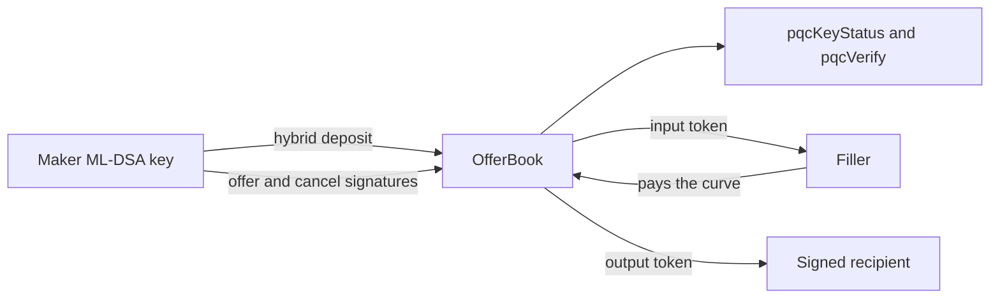
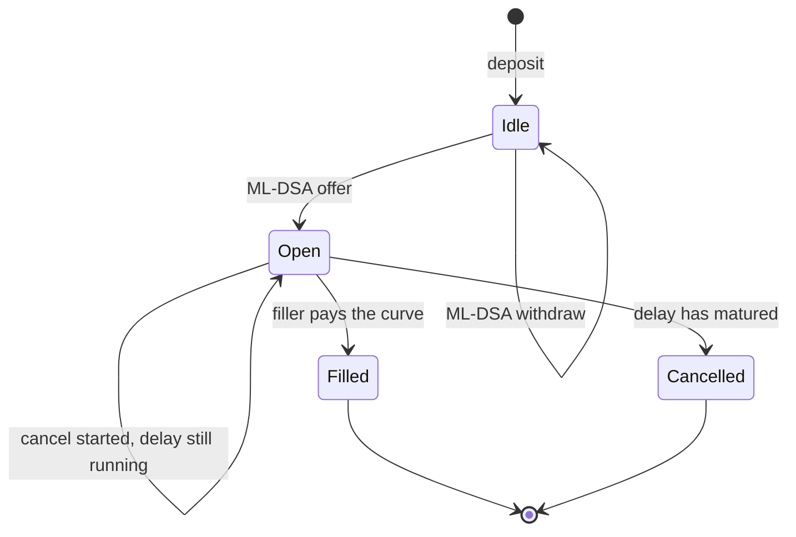
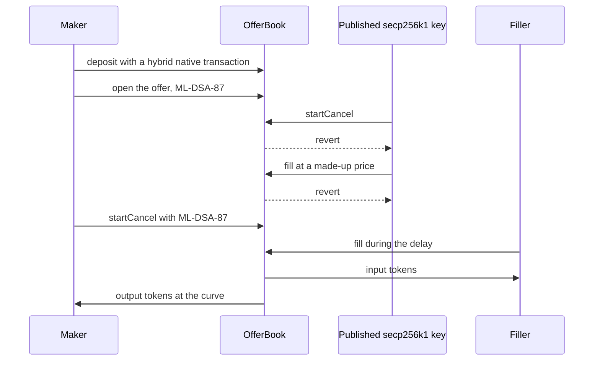

# FIRM

FIRM is a settlement book for firm offers on QoreChain.

A maker locks an input token and signs a price that decays on a straight line. Anyone may buy the inventory at the price the contract computes from that line. The proceeds go to the address named in the signature. A leaked classical key cannot cancel the offer, change the price, or send the proceeds somewhere else. The maker can cancel, and only with their post-quantum key, and that cancel waits out a delay they signed up front. A fill that lands during the delay still clears.

The chain is the QoreChain Diana testnet. The category is Post-Quantum dApp. This repository is the build. The spec is [IMPLEMENTATION.md](IMPLEMENTATION.md). The book is deployed at `0x9faf23f3014c0922ca7d70da87b6783a3d2b5619`.

## The problem

A Dutch offer is a standing promise. From this time to that time, anyone may buy this inventory, and the price follows a curve the seller already signed. A filler who takes it is relying on the promise still being there when the transaction lands.

On an ordinary chain the promise and the cancel are the same secp256k1 key. The seller can pull the offer the moment the market moves against them, which leaves the filler holding a free option. The same key, if it leaks or gets phished, can sign a new order that pays an attacker. A signature that sits in public for hours also publishes the classical public key. That is the key a future quantum computer would forge from.

QoreChain already stops the classical key from sending a native transaction on its own, and from opening an EVM window. What it does not do is turn a resting offer into a hard commitment. A window that lists a token does not choose the recipient or the calldata. An allowance created inside a window keeps working after the window closes. Those are the chain's own rules, in the EVM window reference for v3.2.8.

FIRM puts the inventory in a contract that never asks `msg.sender` who the maker is. The offer, the cancel, and the withdraw are ML-DSA-87 signatures, checked on chain. The classical key can pay gas for someone else. It cannot speak for the inventory.

## An offer

An offer is one object in `OfferBook`.

| Field | What it means |
| --- | --- |
| Maker | The account whose registered ML-DSA-87 key signed the offer |
| Input token | What the maker locked. The filler receives this |
| Output token | What the filler pays |
| Amount | The whole input amount. The contest build fills all of it or none of it |
| Start price and end price | The line, in output base units per 1e18 input base units |
| Start and end | The clock. Before the start, the price is the start price. After the end, the offer is dead |
| Recipient | Where the output goes. The filler does not choose this |
| Cancel delay | How many blocks a cancel must wait. Fills stay open during the wait |
| Fee | Basis points taken from the output, and who receives them. Zero is allowed |

The price at time `t` is a straight line:

```text
before start     start price
after end        end price
in between       start + (end - start) * (t - start) / (end - start)
```

When the end price is below the start price, the line falls. That is the Dutch case we will record. The contract uses unsigned math with a branch, so a falling line does not underflow. Multiply before dividing. A fuzz test checks that the result stays between the two prices, inclusive.

A fill is accepted only when all of this is true:

- The offer is open, and `t` is inside the window.
- A cancel has not reached its maturity block.
- The filler pays the curve price for the full amount. The transaction does not carry a price.
- The output arrives at the signed recipient, and the fee, if any, at the signed fee recipient.
- The input leaves the book for the filler.

The contest demo uses a zero fee so the video is about the price and the refused cancel. The fee fields stay in the signature so a relayer cannot invent one later.

Worked example, in whole tokens. fETH has 18 decimals and fUSD has 6. The price the maker signs is fUSD base units per 1e18 fETH base units, so 20 fUSD is the integer `20 * 10^6`, not `20 * 10^18`. The scale stays `1e18`.

The faucet paid 0.5 fETH, so offer A locks 0.1 fETH. The line is still two hours from 20 fUSD down to 16 fUSD, with a cancel delay of 40 blocks. Diana blocks are about 1.3 seconds, so 40 blocks is a bit under a minute. At the midpoint the contract charges 18 fUSD per fETH, 1.8 fUSD for this size. A filler who sends a price of 1 reverts. The maker's secp256k1 key, which we will publish, reverts on cancel and on withdraw. The maker's ML-DSA-87 key can start the cancel, and a fill before those 40 blocks still clears. The recorded transactions are in [docs/RUN.md](docs/RUN.md).

## What the contract does

One contract. There is no owner and no upgrade.



The maker's secp256k1 key is not on that drawing on purpose. It can broadcast a transaction for a relayer account. Inside `OfferBook` it is not an authority.





Deposit prefers a hybrid `MsgCrossVMCall`, so the maker never opens an EVM window. The docs say that call was re-enabled on Diana by governance proposal 37. We have not re-read the live circuit breaker, because the public REST route we tried returned "Not Implemented". The first coding task is a spike. If the call is refused, the fallback is one short window scoped to the token and the book, three transactions (approve, deposit, approve zero), and the README will say that this fallback has a race the hybrid path does not.

After the tokens are in the book, withdraw is an ML-DSA-87 signature. Closing the maker's window is then enough. The classical key has nothing left to sign that the book will accept.

## What this build includes

The contest build is one book, one pair, and a recorded attack.

We will ship:

- Deposit, open, full fill, delayed cancel, withdraw.
- ML-DSA-87 checked with the Diana precompiles. Forge etches a mock and does not prove FIPS 204. `npm run spike` is the real signature check.
- A linear curve, a cancel delay, and a fee field that the demo sets to zero.
- An attacker script that uses the maker's secp256k1 key and shows the reverts.
- A filler script on a second key we control. That key is operator inventory. It is not a user.
- A page with a landing and an app. A Diana wallet can deposit and fill. Opening, cancelling, and withdrawing stay with the post-quantum signature.
- Two QCAI audit reports and a short map of what we did with each finding.
- `AI_USAGE.md`, written while the work happens.

Later, and not in the submitted build:

- Partial fills, a bond, and a short exclusive window for one filler.
- More than one pair.
- A route to the native AMM. The EVM bridge on Diana can call four allowlisted CosmWasm contracts, and the AMM is not one of them.
- Mainnet. On 22 November 2026 the mainnet precompile list was empty. A book deployed there would refuse every open, if it is written to fail closed, or it would misread empty data, if it is not.
- ML-KEM. The offer has to be readable by fillers. Sealing it would make a different product, and that product already has several entries in the fest.

## Contest

Build Before Q-Day, organised by the QoreChain Association. Building runs until 2 December 2026 at 23:59 UTC. We should submit on 1 December. Checks are 3 to 5 December, judging 6 to 15 December, winners on 16 December.

The category is Post-Quantum dApp. A solo builder can enter. The published prizes are 1,500, 750, and 500 dollars. The submission needs a public repo under MIT or Apache-2.0, a README, a featured image, a video of at most three minutes, and the testnet addresses. This repo is already MIT.

Special awards we will actually prepare for:

- Best AI-Native, which wants `AI_USAGE.md` and the form ticked. It can sit on top of a category prize.
- People's Choice, a QoreX mainnet vote from 6 to 15 December. Three votes per wallet, one per project, no voting for your own project.

Awards we will not plan around:

- Q-Day Survivor. Drill registration closed on 17 November 2026 at 23:59 UTC.
- Protocol Builders. That category is teams of two to four.
- Quantum Campus, unless every person on the team is a student and can prove it.
- The Middle East and Africa regional award, and the Top-Quality awards. Ghana sits in that region if the form says Ghana. Türkiye is a separate region. Both of these awards go only to projects that won nothing else, so they are a fallback.

How this got picked, in short. On 22 November 2026 the public project directory listed 132 projects: 37 post-quantum dApps, 30 Quantum Pass, 27 agent projects, 24 encrypted apps, 7 cross-VM, and 7 protocol builds. The agent track is full of spending limits. The vault track is full of "a leaked ECDSA key cannot withdraw". Sealed auctions, escrow, vesting, and payroll are spoken for. Darwin, a basket token port, and Agama, a private credit vault, are the polish bar. PQ Permit already did gasless ML-DSA allowances. Blind already does a sealed batch swap. Peal Tender already does a uniform-price buyback.

FIRM is the object those do not implement: a public curve a third party can fill, that the classical key cannot pull, with a delay that also binds the real maker for the blocks they signed. The score we gave that bet was 79 out of 100. Usefulness is the weak part, because Diana does not have an outside market maker. The demo filler is ours. If someone outside the team fills a public offer, their hash goes in this README. If nobody does, this README keeps saying so.

## The three minute recording

| Time | Picture |
| --- | --- |
| 0:00 | One sentence on screen: the offer stays up, and the leaked key cannot pull it. The resting line, 20 down to 16 |
| 0:25 | The published secp256k1 key calls cancel, fill at a price of 1, and withdraw. Three reverts |
| 0:50 | The real ML-DSA key starts a cancel. The page shows the maturity block still ahead |
| 1:20 | The filler buys at the curve. Input arrives for the filler. Output arrives for the signed recipient |
| 2:00 | A second, smaller offer shows the other ending: after the delay, fill reverts and the inventory returns |
| 2:25 | The deposit's hybrid verification on the explorer, and a local check that the same ML-DSA signature fails if one bit flips |
| 2:50 | The limits, said out loud: the ML-DSA key can empty the book, mainnet verification is off, and the filler is our second key |

## Users

The person this is for, later, is a filler who will commit capital because the cancel cannot land in the same block. We do not have that person on Diana this month.

The honest first outsider is someone who runs the filler script against an offer we funded and keeps the tokens. We do not call our own second wallet a user. We do not invent a market maker.

## Status

| Piece | State |
| --- | --- |
| Protocol design | Written in IMPLEMENTATION.md |
| Contracts | `OfferBook` and the curve. Forge tests pass |
| Deposit spike | Hybrid `MsgCrossVMCall` of 1 fETH base unit. Hashes are in docs/SPIKE.md |
| Diana deployment | `0x9faf23f3014c0922ca7d70da87b6783a3d2b5619`. `tokenA` is fETH, `tokenB` is fUSD. The deployer window is closed |
| Offer A | Filled during the cancel delay. Hashes are in [docs/RUN.md](docs/RUN.md) |
| Offer B | Cancel matured, fill reverted, input returned to idle. Hashes are in [docs/RUN.md](docs/RUN.md) |
| Page | `npm run page` serves `web/`. The landing is separate from the app. A wallet on Diana can deposit and fill. Open, cancel, and withdraw stay in the scripts. Hashes link to [docs/RUN.md](docs/RUN.md). The explorer opens on mainnet until its header is set to Testnet |
| Audit | Both stages are in [docs/AUDIT.md](docs/AUDIT.md). Stage 1 scored 72. Stage 2 scored 78. Both are risk medium, and quantum readiness is not scored. The PDFs are [docs/audit/2026-11-27-stage-1.pdf](docs/audit/2026-11-27-stage-1.pdf) and [docs/audit/2026-11-28-stage-2.pdf](docs/audit/2026-11-28-stage-2.pdf) |
| Outside filler | Not recruited |
| Video | Not recorded |

Deployed on 25 November 2026. The deployer is `qor1y54dky94wj7sfj80pjmp4vkg7gjv35luf24fxs`. It holds QOR for gas and no fest tokens. Its ML-DSA key is algorithm 1 with `possession_proven` true.

| Step | Hash |
| --- | --- |
| Gas to the deployer | `4CFD5D24BE7684FD72EAE944F9E853304173E12CF42CC92C81EC9B5FC02266AC` |
| Register | `DC3317F0103D9775965B50DBCB173C1DD303E9A862A9B80D2EC62282689CDED4` |
| Open the window | `DD29A39A1D8943174929BA23A530E82A269CCEAA99992A01B6E18BE6FB4CC486` |
| Deploy | `0x6ad3f0a3f7d27b21076111f465a958b12dc752e96087da915d9e3200b939ccde` |
| Close the window | `E6648955F88F78B922E75B07AF15BC02704B964481D181EED6C26AA431006998` |

Code for this project has to be written during the fest. The window opened on 4 November 2026. The deadline is 2 December 2026 at 23:59 UTC.

## Build notes

Foundry is the contract toolchain. Scripts and the page are TypeScript. Day to day work can happen on Windows, with Forge under WSL2. The WSL path for this folder is `/mnt/c/Users/HP/Documents/FIRM`. The book uses OpenZeppelin `ReentrancyGuard` and `SafeERC20`. Tests use forge-std.

Network facts we checked on 22 November 2026:

| What | Value |
| --- | --- |
| Testnet | `qorechain-diana`, EVM chain id 9800 |
| Mainnet | `qorechain-vladi`, EVM chain id 9801 |
| Testnet RPC | `https://evm-testnet.qore.host` |
| Testnet REST | `https://api-testnet.qore.host` |
| `pqcVerify` | `0x0000000000000000000000000000000000000a01`, active on Diana, absent on mainnet |
| `pqcKeyStatus` | `0x0000000000000000000000000000000000000a02`, same split |
| Signature | ML-DSA-87, FIPS 204. Public key 2,592 bytes. Signature 4,627 bytes. Empty context. The precompile does not hash the message |
| Key check | Algorithm id 1, and `possessionProven` true. A registered key without a proof is not enough |

The pair is the official Diana fest tokens. On 23 November 2026, `symbol()` and `decimals()` on `https://evm-testnet.qore.host` matched the faucet documentation.

| Token | Decimals | ERC-20 |
| --- | --- | --- |
| fETH | 18 | `0x02292293c13880a26242690eb70a0e42B8E91c28` |
| fUSD | 6 | `0x97143B771D34ddb9130b807b135Ae675A5a963CA` |

fBTC (`0x4604e7E45b2ecdbfbDc157103f5B2b62cb16451A`, 8 decimals) is on Diana and is not used. These tokens are not on mainnet. Tests still use 18 decimal mocks so the curve numbers stay readable. The signed demo prices use fUSD's 6 decimals, as in the worked example above.

Source: [QoreChain faucet](https://docs.qorechain.io/dashboard/faucet/).

## License

MIT. See [LICENSE](LICENSE).
